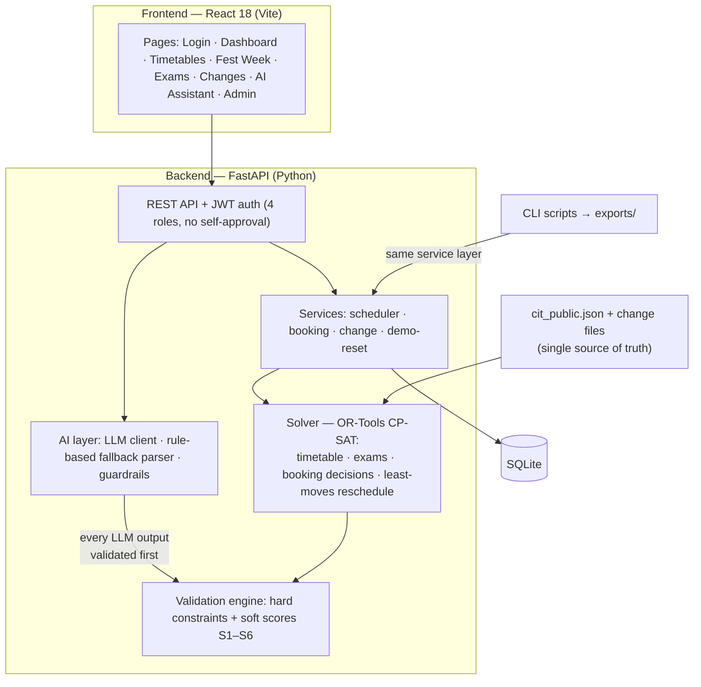

# Crunch Week — CIT Campus Scheduling & Venue Management

A web platform for **Chilika Institute of Technology (CIT)** that generates the semester
timetable, manages venue bookings, and handles last-minute changes **without creating new
clashes** — the exact problem that makes Week 7 (regular classes + midsem prep + Spectra
tech fest) the most chaotic week of the semester.

Built for the **Crunch Week hackathon**.

---

## What it does

| # | Capability |
|---|------------|
| 1 | Generates a clash-free weekly timetable for **all 189 sessions** (lectures, tutorials, 3-hour labs) across **27 rooms** |
| 2 | Schedules **41 midsem exams** for exam week (AM/PM slots, half-capacity rooms, multi-room exams) |
| 3 | Accepts venue requests in **plain English or Hinglish** ("seminar hall kal shaam 6 baje, 100 log, mic chahiye"), converts them into structured, editable bookings before submission |
| 4 | **Approves / rejects / offers alternatives** for all 25 Spectra week booking requests, following role-based priority rules, with a **reason for every decision** |
| 5 | Handles disruptions (faculty leave, room closure, session add/remove) — proposes a fix that **moves as few sessions as possible**, shows exactly what changed, and applies it **only after Admin approval**. If no valid fix exists, it reports which constraints conflict |
| 6 | Shows timetables **by group, faculty and room**, plus pending approvals, current conflicts and room utilisation |
| 7 | **AI assistant** for natural-language schedule-change requests — every AI proposal is strictly validated by the platform's own constraint engine before it can change any data |
| 8 | **Explainable decisions** — ask why a class is at 8 AM or why a booking was rejected and get an answer |
| 9 | Admin can load the dataset, apply change files, and export `schedule.json` (timetable + exams + booking decisions) |
| 10 | Manual event scheduling for authorized roles, strictly constrained |

**Important:** the platform solves the dataset it is given — nothing from
`cit_public.json` is hard-coded. All outputs are produced by the app's own solver;
`exports/` files are never created or edited by hand.

---

## Architecture



**Design decisions**

- **Solver is standalone.** The web UI and the CLI export scripts call the *same*
  service layer, so `exports/schedule.json` and `exports/schedule_after.json` are always
  genuinely app-generated.
- **Validation is separate from the AI.** The LLM only parses language and fills forms;
  whether a schedule or booking is valid is decided **exclusively by our own code**
  (`backend/app/validation/`). No validity check depends on an LLM.
- **Least-moves rescheduling.** The rescheduler gives every session a bonus for keeping
  its current slot, so a disruption repairs the timetable with minimal movement, and the
  diff (what moved, where, why) is shown before Admin approval.
- **Graceful AI fallback.** If the LLM API is unavailable or out of credits, the manual
  booking form and a rule-based parser keep working — the product never goes down.

---

## Tech stack

| Layer | Technology |
|-------|-----------|
| Frontend | React 18 (JSX), Vite, react-router, custom CSS design system |
| Backend | Python 3.10+, FastAPI, Pydantic v2, SQLAlchemy 2 |
| Solver | Google OR-Tools (CP-SAT) + local-search polish |
| Database | SQLite (via SQLAlchemy) |
| Auth | JWT (python-jose + bcrypt), 4 roles: Admin, Dept Coordinator, Faculty, Club Rep |
| AI | OpenAI-compatible chat API (stdlib urllib) + in-repo rule-based fallback parser |
| Official checker | `validator/validator.py` (starter pack, unmodified) |

Full third-party declarations: [`THIRD_PARTY.md`](THIRD_PARTY.md) · AI use declaration: [`AI_USAGE.md`](AI_USAGE.md)

---

## Project structure

```
zoho/
├── README.md                        # this file
├── AI_USAGE.md                      # every AI model/tool used, and what the LLM may NOT decide
├── THIRD_PARTY.md                   # every library/solver used
├── .env.example                     # all environment variables (no real keys)
├── exports/                         # ★ produced by the app (CLI + admin export button)
│   ├── schedule.json
│   └── schedule_after.json
├── validator/
│   └── validator.py                 # official validator (starter pack, unmodified)
├── examples/                        # sample_disruption.json, sample requests, export shape
├── scripts/
│   ├── generate_schedule.py         # CLI: solve dataset → exports/schedule.json
│   ├── generate_schedule_after.py   # CLI: apply sample_disruption → exports/schedule_after.json
│   └── run_validator.sh
├── backend/
│   ├── requirements.txt
│   └── app/
│       ├── main.py                  # FastAPI entrypoint (CORS, routers, startup seed)
│       ├── config.py / database.py / models.py
│       ├── data/cit_public.json     # the dataset (read-only source of truth)
│       ├── dataset/                 # loader, Context index views, change-file application
│       ├── solver/                  # timetable.py (2-phase CP-SAT) · exams.py · bookings.py
│       │                            #   local_search.py (soft-score polish) · pipeline.py
│       ├── validation/              # checks.py — wraps the official validator (sole truth)
│       ├── ai/                      # llm_client (no-key fallback) · parser (booking, Hinglish)
│       │                            #   change_parser (disruptions) · service (explanations)
│       ├── services/                # state.py (dataset/solution/reset/audit) · jobs.py
│       │                            #   scheduler_service.py (generate/rebook/propose/apply)
│       └── api/                     # auth · timetable · bookings · changes · admin
│                                    #   dashboard · ai
└── frontend/
    └── src/
        ├── api.js                   # JWT fetch client
        ├── App.jsx                  # router, sidebar layout, toasts
        └── pages/                   # Login · Dashboard · Timetable (week/group/faculty/room)
                                     #   Bookings (AI draft + form + decisions) · Exams
                                     #   Changes (NL + structured + diff + approve)
                                     #   Admin · Assistant
```

---

## Getting started

Prerequisites: **Python 3.10+** and **Node 18+**.

```bash
# 1. Backend
cd backend
python3 -m venv .venv
source .venv/bin/activate
pip install -r requirements.txt
cp ../.env.example ../.env          # fill in LLM keys (optional — see below)

# 2. Frontend
cd ../frontend
npm install
npm run dev                         # Vite dev server, proxies /api → :8000

# 3. Backend (in a second terminal)
cd ../backend
source .venv/bin/activate
uvicorn app.main:app --reload --port 8000
```

The app serves at `http://localhost:5173`, API at `http://localhost:8000` (docs at `/docs`).

### Generating the exports

```bash
python scripts/generate_schedule.py          # → exports/schedule.json
python scripts/generate_schedule_after.py    # → exports/schedule_after.json
```

Both run the same solver pipeline the web app uses. The Admin panel has an **Export**
button that does the same thing from the UI.

### Checking with the official validator

```bash
python3 validator/validator.py \
    --data backend/app/data/cit_public.json \
    --schedule exports/schedule.json

python3 validator/validator.py \
    --data backend/app/data/cit_public.json \
    --schedule exports/schedule_after.json \
    --disruption examples/sample_disruption.json \
    --baseline exports/schedule.json
```

The validator reports hard violations by rule, soft penalty (S1–S6), booking score,
priority inversions, and how many sessions moved.

---

## Demo accounts

Use these on the deployed link (also listed here per the submission rules).
The **Admin** dashboard has a **"Reset demo data"** button to start from a clean state.

| Role | Login | Password |
|------|-------|----------|
| Admin (Dean's office) | `admin@cit.edu.in` | `Admin@123` |
| Dept Coordinator (CSE) | `coordinator@cit.edu.in` | `Coord@123` |
| Faculty | `faculty@cit.edu.in` | `Faculty@123` |
| Club Representative | `club@cit.edu.in` | `Club@123` |

Role permissions follow the problem statement: nobody can approve their own request;
only Admin can change the priority order or approve bookings that move regular classes.

---

## Environment variables

See [`.env.example`](.env.example). Summary:

| Variable | Required | Purpose |
|----------|----------|---------|
| `OPENAI_API_KEY` | *optional* | Enables the LLM assistant + plain-language booking parser |
| `OPENAI_BASE_URL` | *optional* | Use any OpenAI-compatible endpoint |
| `LLM_MODEL` | *optional* | Model name (default in `.env.example`) |
| `JWT_SECRET` | yes (set in `.env`) | Token signing (dev default in code) |
| `DATABASE_URL` | no | Defaults to `sqlite:///<backend>/app/data/crunchweek.db` |
| `TEAM_NAME` | no | Stamped into exported `schedule.json` |
| `CORS_ORIGINS` | no | Allowed origins (default: dev origins) |

No LLM key → the assistant degrades to the rule-based parser and the manual form;
everything else works.

---

## Judging & submission

- `exports/schedule.json` + `exports/schedule_after.json` — app-generated, validator-checked
- Live deployed link (kept up until results are announced)
- ≤ 5-minute walkthrough video (timetable generation, plain-language → booking, a blocked
  conflict, Spectra decisions, a rescheduling with approval, dashboard)

## Known limitations

- Single dataset (`cit-public-v1`); the solver is dataset-driven but only this public
  dataset is bundled and tested.
- SQLite — fine for a demo deployment (single instance), not a production multi-node choice.
- The rule-based fallback parser covers the request patterns in `examples/sample_requests.md`;
  genuinely ambiguous requests are answered with follow-up questions instead of a guess.
- Disruption repairs optimise for *fewest moved sessions* under all hard constraints; the
  objective does not re-trade soft scores unless Admin requests a full regeneration.
